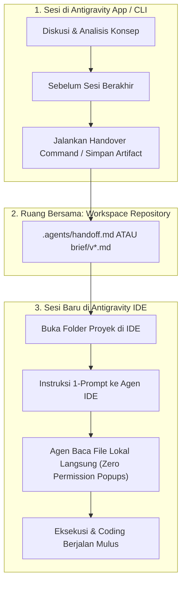

# Brief v03: Panduan Migrasi & Transisi Konteks Antigravity App ke Antigravity IDE

Dokumen ini mendokumentasikan arsitektur internal, akar masalah gesekan (*friction*), serta prosedur standar operasional (SOP) untuk memindahkan atau melanjutkan percakapan (*conversation context*) dari **Antigravity App / CLI** ke **Antigravity IDE**.

---

## 1. Arsitektur & Anatomi Penyimpanan

Antigravity CLI/App dan Antigravity IDE beroperasi pada dua lingkungan proses dan direktori runtime yang **terisolasi**:

```
C:\Users\<User>\.gemini\
├── antigravity\                     # [Lingkungan A] CLI / Standalone App
│   ├── brain\<convo-id>\            # Artifacts, logs, scratch files
│   │   └── .system_generated\logs\
│   │       ├── transcript.jsonl     # Log ringkas (token-efficient / truncated)
│   │       └── transcript_full.jsonl# Log penuh tanpa truncate
│   ├── conversations\<convo-id>.db  # SQLite database percakapan
│   └── annotations\<convo-id>.pbtxt # Metadata sesi
│
└── antigravity-ide\                 # [Lingkungan B] Antigravity IDE
    ├── brain\<ide-convo-id>\        # Sesi percakapan IDE
    ├── conversations\
    └── mcp\                         # MCP servers IDE
```

### Mengapa Terjadi Gesekan Saat Membawa `Conversation ID` ke IDE?

1. **Database Terpisah:** IDE tidak membaca tabel SQLite atau folder `brain/` milik Antigravity CLI/App secara otomatis karena prefix jalurnya berbeda (`antigravity` vs `antigravity-ide`).
2. **Kebijakan Batas Keamanan Sistem (Sandbox Protection Boundary):**
   - Tool inspeksi file agen (`view_file`, `list_dir`, `grep_search`) dibatasi oleh aturan keamanan untuk tidak membaca langsung folder internal pengguna di `C:\Users\<User>\.gemini\...`.
   - Kegagalan ini memicu status: `Encountered error in step execution: Permission denied for read_file(...). Matches default system policy.`
3. **Approval Fatigue (Dialog Izin Berulang):**
   - Karena tool pembaca file terhalang batas sandbox, agen terpaksa mencoba membaca via `run_command` terminal (`powershell` / `cmd`).
   - Pada Antigravity IDE, setiap eksekusi perintah terminal secara default memicu modal konfirmasi ke pengguna (`Allow` / `Deny`). Jika agen mengeksekusi banyak langkah eksplorasi kecil, pengguna akan mengalami *approval fatigue*.
4. **Log Truncation pada `transcript.jsonl`:**
   - Pesan yang memiliki isi teks panjang (seperti file draf, diff kode, atau keluaran analitis) dipotong oleh sistem pada file `transcript.jsonl` dan ditandai dengan `"truncated_fields": ["content"]`.
   - Konten lengkapnya hanya ada di `transcript_full.jsonl`.

---

## 2. Diagram Alur Transisi Konteks yang Efisien



---

## 3. Tiga Metode Migrasi Konteks

### Metode 1: Workspace-Centric Handover (Metode Terbaik & Tanpa Dialog Izin ⭐)

Daripada menyalin atau mencari UUID percakapan di direktori sistem, jadikan workspace proyek sebagai jembatan *single source of truth*.

**Langkah di Antigravity App / CLI (Sebelum Pindah):**
Ketik instruksi penutup seperti ini ke agen:
```text
Rangkum status percakapan kita dan tulis ke file .agents/handoff.md di workspace ini. Sertakan:
1. Keputusan arsitektur yang sudah disepakati.
2. File yang perlu dibuat/diedit selanjutnya.
3. Contoh kode/draf yang belum sempat disimpan.
```

**Langkah di Antigravity IDE (Saat Membuka Sesi Baru):**
Cukup ketik:
```text
Baca .agents/handoff.md dan lanjutkan tugas nomor 2.
```
> **Keuntungan:** Tool agen IDE langsung membaca `.agents/handoff.md` di dalam workspace tanpa perlu izin terminal sama sekali.

---

### Metode 2: Bridge via Workspace Temporary Copy (Jika Sesi App Sudah Tertutup)

Jika sesi di Antigravity App sudah terlanjur selesai dan Anda hanya memiliki Conversation ID (contoh: `55cdad08-31d3-463b-a1f5-0e6d8d70a038`):

1. **Jangan biarkan agen menjalankan script terminal berkali-kali.**
2. Salin file log lengkap ke dalam root workspace sekali saja melalui terminal Anda:
   ```powershell
   copy "C:\Users\$env:USERNAME\.gemini\antigravity\brain\<CONVERSATION_ID>\.system_generated\logs\transcript_full.jsonl" ".\temp_convo.jsonl"
   ```
3. Minta agen IDE membaca file tersebut:
   ```text
   Baca file temp_convo.jsonl di workspace ini, ambil draf brief terakhir, lalu tuliskan ke brief/v01... dan brief/v02...
   ```
4. Setelah selesai, hapus `temp_convo.jsonl`.

---

### Metode 3: Context Capsule Prompting (Manual 3-Poin)

Jika perpindahan bersifat ad-hoc tanpa file log:

Gunakan format prompt ringkas 3-poin:
```text
[Konteks Migrasi]
- Project: Git Rescue (Website Simulasi Masalah Git Pemula)
- Keputusan Sebelumnya: Gunakan skenario IRL, analogi 3-level, dan Raw File Lab (hindari pendekatan kamus statis seperti GitAtlas).
- Tugas Sekarang: Tulis file brief/v01_first-thought.md dan brief/v02_brief-diffrent-from-other-alternative.md.
```

---

## 4. Penanganan Masalah Khusus (Troubleshooting)

### A. Mengatasi Eror Hook Plugin (`MODULE_NOT_FOUND`)
Jika Anda mendapati eror yang menggagalkan tool agen seperti:
```text
JSON hook "jsonhook__googlecloudtools.datacloud_telemetry_PreToolUse_0_0" failed: 
Cannot find module 'C:\Users\<user>\.gemini\config\plugins\googlecloudtools.datacloud_telemetry\"C:\Users\<user>\...'
```
* **Penyebab:** Masalah formatting tanda kutip ganda pada registrasi path plugin di file konfigurasi.
* **Solusi:** Nonaktifkan sementara plugin tersebut di `C:\Users\<User>\.gemini\config\plugins\googlecloudtools.datacloud_telemetry` atau hapus registrasinya di `hooks.json`.

### B. Mencegah Approval Fatigue di IDE
Jika Anda ingin agen bekerja mandiri pada tugas batching:
1. Pastikan tugas penulisan file menggunakan perintah penulisan langsung (`write_to_file`) dan bukan lewat skrip terminal `echo` / `Out-File`.
2. Kelola pengaturan persetujuan eksekusi terminal di preferensi ekstensi Antigravity jika tersedia opsi mode auto-allow untuk perintah read-only.

---

## 5. Ringkasan Checklist Transisi Cepat

- [ ] Simpan draf kerja ke folder workspace (`brief/`, `docs/`, atau `.agents/`).
- [ ] Hindari mengandalkan pembacaan folder internal `~/.gemini/` secara lintas aplikasi.
- [ ] Jika perlu log penuh, gunakan `transcript_full.jsonl`, bukan `transcript.jsonl` (agar tidak terpotong).
- [ ] Berikan prompt pembuka di IDE dengan referensi file lokal workspace yang jelas.
