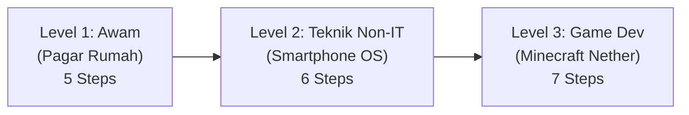

# Brief v05: Peran & Spesifikasi Manim untuk Visualisasi Edukasi Git Rescue

Dokumen ini menjelaskan arsitektur, peran strategis, serta justifikasi penggunaan **Manim (Mathematical Animation Engine)** sebagai mesin perender visualisasi analogi bertingkat pada proyek *Git Rescue*.

---

## 1. Mengapa Menggunakan Manim?

Manim (awalnya diciptakan oleh Grant Sanderson / *3Blue1Brown*) adalah framework animasi programatik berbasis Python yang dirancang khusus untuk memvisualisasikan konsep abstrak dengan presisi matematis dan estetika tingkat tinggi.

Dalam proyek *Git Rescue*, Manim memecahkan tantangan terbesar dalam edukasi Git: **menjembatani objek metafora fisik (cat pagar, lapisan OS, blok voxel) dengan grafik Directed Acyclic Graph (DAG) commit Git secara bersamaan dan tersinkronisasi (*dual-viewport synchronization*).**

### Keunggulan Manim Dibandingkan Video Editing Manual / Tool Lain:
1. **Presisi Sinkronisasi Terprogram (*Programmatic Timing*):** Setiap perubahan pada objek metafora (misal: panel pagar dicat kuning) dapat dianimasikan pada milidetik yang sama persis dengan munculnya cabang pointer branch baru (`motif-kuning`) pada grafik Git.
2. **Animasi Vektor Murni (*SVG / Mathematical Primitives*):** Bebas pecah resolusi (*resolution-independent*), rendering tajam dari layar HP hingga proyektor 4K saat sidang skripsi.
3. **Reproducibility & Modularity:** Jika teks skenario diubah, kita cukup mengubah variabel script Python tanpa perlu menganimasi ulang dari nol.
4. **Asset Export Fleksibel:** Dapat diekspor menjadi video pendek MP4/WebM untuk mode *"Watch"*, atau dipecah menjadi keyframe SVG/Lottie untuk interaktivitas ringan di browser web.

---

## 2. Format Antarmuka Layar Terbelah (*Split-Screen Layout Architecture*)

Dalam setiap adegan Manim, kanvas layar dibagi menjadi **dua zona viewport terintegrasi**:

```
┌────────────────────────────────────────────────────────┐
│ [ZONA ATAS: 55% TINGGI LAYAR]                          │
│ METAFORA DUNIA NYATA (Real-World Analogical Canvas)     │
│ - Level 1: Pagar Besi & Kuas Cat Dinamis               │
│ - Level 2: Smartphone Exploded-View & Layer OS         │
│ - Level 3: Minecraft Voxel Isometric Island            │
├────────────────────────────────────────────────────────┤
│ [ZONA BAWAH: 45% TINGGI LAYAR]                         │
│ REAL-TIME GIT DAG GRAPH & TERMINAL PROMPT              │
│ - Simpul Commit (A, B, C...) berkedip & menyambung     │
│ - Pointer Branch (main, feature, HEAD) bergerak mulus  │
│ - Teks Perintah: $ git checkout -b ...                 │
└────────────────────────────────────────────────────────┘
```

Dengan layout ini, mata pengguna secara intuitif memahami hukum kausalitas:  
> *"Setiap tindakan fisik di atas memiliki padanan struktur data Git di bawah."*

---

## 3. Rencana Eksekusi 3 Contoh Representatif (*Demo Showcase*)

Tiga kasus terpilih mewakili spektrum 3 level pemahaman:



### 3.1 Level 1: Dekorasi Pagar Rumah (5 Steps)
- **Tantangan Visual:** Menampilkan pagar besi yang berubah warna secara bertahap dari abu-abu ke hijau, panel cabang independen, penghapusan cabang yang gagal, dan pernis berkilau.
- **Tantangan Graf Git:** Menampilkan pointer `HEAD` dan branch `main`, percabangan `motif-kuning`, pembongkaran branch (*dangling commit fade-out*), dan stempel `tag: v1.0`.

### 3.2 Level 2: Lapisan Smartphone, Firmware & Hardware (6 Steps)
- **Tantangan Visual:** Menampilkan diagram isometrik ponsel pintar bertingkat (*exploded layer view*: Chipset ➔ Firmware OS ➔ UI Aplikasi Kamera). Animasi crash kamera saat update OS 15 beta.
- **Tantangan Graf Git:** Menunjukkan `main` baseline, `beta-os-15` branch, investigasi `git log`, rollback instan via `git reset --hard` yang mengembalikan kamera normal, serta commit `CHANGELOG.md`.

### 3.3 Level 3: Minecraft Nether Update (7 Steps)
- **Tantangan Visual:** Menampilkan pulau voxel 3D (Overworld hijau), dimensi portal Nether merah menyala, efek tabrakan blok ungu-hitam (*missing texture*), snapshot mingguan, dan penggabungan dimensi.
- **Tantangan Graf Git:** Menampilkan branching ekspansi, deteksi tabrakan registry, refactoring commit, release tag snapshot `24w36a`, non-fast-forward merge (`--no-ff`), dan major milestone tag `v1.16.0`.

---

## 4. Pipeline Integrasi Manim ke Web Git Rescue

1. **Tahap Render Python:**  
   Script Manim dijalankan dengan parameter kualitas optimal (misal `-pqh` untuk 1080p 60fps atau `-pql` untuk preview cepat).
2. **Kompresi Web-Friendly:**  
   Output dikonversi menjadi WebM transparan / video MP4 terkompresi H.264 (< 2 MB per video klip).
3. **Pemasangan di Web Git Rescue:**
   - Masuk ke **View 6: Story** pada tab *"Watch Video"* yang hanya dimuat saat kartu diketuk (*lazy-loaded video*), menghemat kuota internet pengguna ponsel.
   - Disertai ringkasan teks dan grafik SVG interaktif sebagai cadangan jika video tidak diputar.
